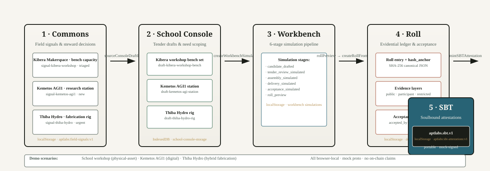
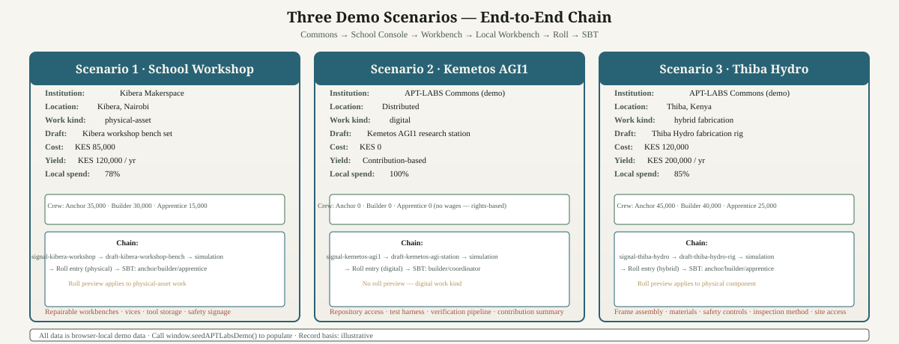
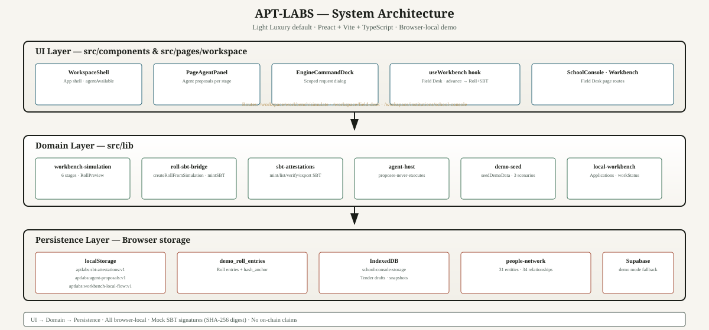

# APT-LABS — System Reference

This is the consolidated system reference for the APT-LABS "dreamer" codebase. It replaces scattered spec files and is kept open so any agent can understand the system, extend it, and verify its behavior without hunting across documents.

**What this doc is:** a single source of truth for what exists, how the pieces fit, and where to find them.
**What this doc is not:** a directive, a roadmap, or a permission slip. It describes reality, not intent.

---

## 1. What APT-LABS Is

APT-LABS is infrastructure for making fragmented productive capacity visible, connectable, governable, locally retained, and cumulative.

It begins with a practical problem: people, crews, institutions, assets, skills, needs, opportunities, work, and evidence exist throughout African economies, but their relationships are fragmented, difficult to discover, difficult to coordinate, and poorly represented in systems that allocate resources and recognize value.

APT-LABS makes these relationships legible and actionable.

**The underlying progression:**

Reality → structured records → relationships → coordinated work → verified outcomes → reusable intelligence → economic value.

**The platform is not fundamentally:**
- A social network
- A conventional job board
- A generic marketplace
- A collection of institutional dashboards
- A blockchain or SBT product
- A generic project-management application
- An AI chatbot with business-themed screens

Those may describe isolated features or possible distribution channels. None describes the core.

The deeper product is an **operating and economic network for productive activity**, especially physical and institutional work.

---

## 2. The Five Modules

APT-LABS has one workspace and one shared underlying system. The primary modules are:

| Module | Job | Route |
|--------|-----|-------|
| **Commons** | Discover and express needs, offers, resources, opportunities, knowledge, problems | `/workspace/commons` |
| **Network** | Understand and connect people, crews, institutions, assets, capabilities, relationships | `/workspace/people`, `/workspace/institutions`, `/workspace/institutions/network` |
| **Workbench** | Scope, assemble, coordinate, manage productive work | `/workspace/workbench`, `/workspace/workbench/simulate`, `/workspace/field-desk` |
| **Records** | Inspect durable history, provenance, evidence, credentials, attestations | `/workspace/roll`, `/workspace/annals` |
| **Intelligence** | Agents, graph analysis, matching, forecasting, analytics | `/workspace/apt-coin-lab` |

**School Console** is a nested operational boundary under Workbench (a workplace where people take jobs), not a primary module: `/workspace/institutions/school-console`.

**Hard navigation constraints:**
- No Main/Branch workspace modes.
- No sixth primary module unless a genuinely independent user job cannot fit into the five.
- No duplicate navigation systems inside individual pages.
- No workspace-within-workspace architecture unless an actual permission or operational boundary requires it.

---

## 3. Canon, Annals, and Roll

Three complementary ways of understanding the system. They must remain conceptually distinct while being navigable together.

| Lens | What it answers | Data source |
|------|----------------|-------------|
| **Canon** — what is structurally recorded | Entities, identities, typed relationships, accepted state | `people-network.ts` + RollEntry hash anchors |
| **Annals** — what happened over time | Chronological events, changes, decisions, transitions, actors | `local-workflows.ts` + workbench simulation stages |
| **Roll** — why a claim or outcome can be substantiated | Evidence, provenance, attestations, verification, supporting material | `db/roll.ts` RollEntry + SBT attestations |

**Never-equate distinctions kept visible:**
- Person ≠ Asset
- Capability ≠ Credential
- Claim ≠ Evidence
- Approval ≠ Authorization ≠ Execution ≠ Acceptance ≠ Settlement

---

## 4. End-to-End Flow

The operating core chains Commons → School Console → Workbench → Local Workbench → Roll → SBT.



### Stage by stage

1. **Commons** — A field signal is recorded (e.g., "Community workshop bench capacity" at Kibera Makerspace). It links to a School Console tender draft via `sourceConsoleDraftId`.

2. **School Console** — A tender draft is created scoping the need: asset name, blueprint lines, crew wage allocation, economic model. Three drafts are seeded for the demo scenarios.

3. **Workbench** — A simulation is composed from a School Console need draft. Six stages: `candidate_drafted → tender_review_simulated → assembly_simulated → delivery_simulated → acceptance_simulated → roll_preview`. Roll preview applies only to `physical-asset` work kind.

4. **Local Workbench** — A local application is created against a work opportunity. It progresses through `submitted → under_review → selected → authorization_pending → authorized → in_progress → submitted → accepted`. On acceptance, a Roll entry is created and SBT attestations are minted.

5. **Roll** — A Roll entry is created from a completed simulation with roll preview, or from an accepted local work application. It contains participants with capability claims, evidence layers (public/participant/restricted), an acceptance block, and a `hash_anchor` (SHA-256 of canonical JSON).

6. **SBT** — Soulbound-style attestations are minted for each participant role (anchor/builder/apprentice/coordinator). Stored in `localStorage` under `aptlabs:sbt-attestations:v1`. Portable export as `aptlabs.sbt.v1` JSON. Demo mock: SHA-256 digest signatures, not on-chain claims.

---

## 5. Three Demo Scenarios

Realistic sample data is seeded via `window.seedAPTLabsDemo()` from the browser console.



### Scenario 1 — School Workshop (physical-asset)

| Field | Value |
|-------|-------|
| Institution | Kibera Makerspace |
| Location | Kibera, Nairobi |
| Asset | Kibera workshop bench set |
| Work kind | physical-asset |
| Build cost | KES 85,000 |
| Projected annual yield | KES 120,000 |
| Local spend | 78% |
| Crew wages | Anchor 35,000 · Builder 30,000 · Apprentice 15,000 |
| Blueprint | Workbench top ×4 · Bench vice ×4 · Tool cabinet ×2 · Safety signage ×1 |

Roll preview applies (physical-asset work). SBT attestations minted for anchor/builder/apprentice roles.

### Scenario 2 — Kemetos AGI1 (digital)

| Field | Value |
|-------|-------|
| Institution | APT-LABS Commons (demo) |
| Location | Distributed |
| Asset | Kemetos AGI1 research station |
| Work kind | digital |
| Build cost | KES 0 |
| Local spend | 100% |
| Crew wages | None (rights-based, contribution-based) |

No roll preview (digital work kind). SBT attestations minted for builder/coordinator roles.

### Scenario 3 — Thiba Hydro (hybrid fabrication)

| Field | Value |
|-------|-------|
| Institution | APT-LABS Commons (demo) |
| Location | Thiba, Kenya |
| Asset | Thiba Hydro fabrication rig |
| Work kind | hybrid fabrication |
| Build cost | KES 120,000 |
| Projected annual yield | KES 200,000 |
| Local spend | 85% |
| Crew wages | Anchor 45,000 · Builder 40,000 · Apprentice 25,000 |

Roll preview applies to physical component. SBT attestations minted for anchor/builder/apprentice roles.

---

## 6. System Architecture



### UI Layer — `src/components` & `src/pages/workspace`

| Component | File | Purpose |
|-----------|------|---------|
| WorkspaceShell | `src/components/WorkspaceShell.tsx` | App shell, `agentAvailable` flag |
| PageAgentPanel | `src/components/workbench/PageAgentPanel.tsx` | Agent proposals per simulation stage |
| EngineCommandDock | `src/components/EngineCommandDock.tsx` | Scoped request dialog ("Ask engine") |
| useWorkbench hook | `src/pages/workspace/field-desk/useWorkbench.ts` | Simulation state, advance → Roll + SBT |

### Domain Layer — `src/lib`

| Module | File | Purpose |
|--------|------|---------|
| Workbench simulation | `src/lib/workbench-simulation.ts` | 6-stage pipeline, RollPreview |
| Roll → SBT bridge | `src/lib/roll-sbt-bridge.ts` | `createRollFromSimulation()`, `mintSBTForAcceptedLocalWork()` |
| SBT attestations | `src/lib/sbt-attestations.ts` | Mint/list/verify/export SBT |
| Agent host | `src/lib/agent-host.ts` | `AgentHost` class, proposes-never-executes |
| Demo seed | `src/lib/demo-seed.ts` | `seedDemoData()`, 3 scenarios |
| Local workbench | `src/lib/local-workbench.ts` | Applications, workStatus state machine |
| Roll DB | `src/lib/db/roll.ts` | RollEntry, hash_anchor, evidence layers |
| School Console storage | `src/lib/school-console-storage.ts` | Tender drafts, IndexedDB snapshots |
| Local workflows | `src/lib/local-workflows.ts` | Field signals, work opportunities |
| People network | `src/lib/people-network.ts` | 31 entities, 34 relationships |

### Persistence Layer — Browser storage

| Storage | Key | Holds |
|---------|-----|-------|
| localStorage | `aptlabs:sbt-attestations:v1` | SBT attestations |
| localStorage | `aptlabs:agent-proposals:v1` | Agent proposals |
| localStorage | `aptlabs:workbench-local-flow:v1` | Local workbench applications |
| localStorage | `demo_roll_entries` | Roll entries |
| IndexedDB | school-console-storage | Tender draft snapshots |

---

## 7. Design System

**Signature Dark Instrument** is the active design proposal (charter Decision B4, 2026-11-10): deep green-black signature default, light variant. Implementation requires separate authorization. Current code in `src/tokens.css` implements Light Luxury as the `:root` default with `[data-skin="dark"]` as the variant; this will be reconciled in a future implementation phase.

| Token | Dark signature (proposal) | Light variant |
|-------|---------------------------|---------------|
| `--bg` | `#0A0F0C` (green-black) | `#F7F5F0` (warm cream) |
| `--fg` | `#E9F1E8` (bone) | `#1A1D18` (deep ink) |
| `--muted` | `#8FA08C` (moss) | `#4A5A52` (refined moss) |
| `--state-canon` | `#7FC5BC` (teal) | `#286375` (teal) |
| `--state-proposed` | `#C9F292` (lime) | `#3D7158` (green) |
| `--state-risk` | `#E89670` (coral) | `#A5533D` (coral) |
| `--state-caution` | `#CBAF6E` (amber) | `#B8955A` (amber) |

**Typography:**
- Serif (Georgia): record/page names
- Sans (system-ui): interface text
- Mono (JetBrains Mono): IDs, timestamps, state labels

**PageHead hierarchy:** L1 serif record name → L2 sans subtitle → L3 mono instrument readout.

**Signature devices:** surveyor grid, fork glyph, ringed evidence markers — used selectively, never decorative.

---

## 8. Trust, Credentials, and SBTs

Credentials and Soulbound Tokens are optional representations of attestations. They are not the foundation of APT-LABS. Evidence comes before badges.

A credential should communicate:
- What claim is being made
- Who issued or attested to it
- What evidence supports it
- What scope and context it applies to
- When it was issued
- Whether it expires, is revoked, or is disputed
- Who may verify it

**Never:**
- Invent a universal reputation score
- Place sensitive personal information on a public blockchain
- Make blockchain ownership a prerequisite for productive work
- Introduce cryptography for visual prestige

**SBT in this demo:** mock proto, localStorage only, SHA-256 digest signatures, portable `aptlabs.sbt.v1` format. No on-chain claims.

---

## 9. How to Run

```sh
npm ci          # install dependencies
npm run dev     # start dev server
npm run build   # production build (tsc + vite)
npm run test:unit -- --run  # vitest, 17 files, 123 tests
```

Seed demo data: open the browser console and run `window.seedAPTLabsDemo()`.

---

## 10. Key Files to Know

| File | Why it matters |
|------|----------------|
| `src/tokens.css` | Design tokens — light luxury default, dark variant |
| `src/App.tsx` | Route switch (wouter) |
| `src/components/WorkspaceShell.tsx` | App shell, `agentAvailable` |
| `src/lib/demo-seed.ts` | Demo data — 3 scenarios, callable from browser console |
| `src/lib/roll-sbt-bridge.ts` | Roll → SBT bridge |
| `src/lib/sbt-attestations.ts` | SBT attestation library |
| `src/lib/agent-host.ts` | Agent host — proposes-never-executes |
| `src/lib/local-workbench.ts` | Local workbench — applications, workStatus |
| `src/lib/db/roll.ts` | Roll entries — hash_anchor, evidence layers |
| `src/lib/school-console-storage.ts` | School Console — tender drafts, IndexedDB |

---

## 11. Open Questions / Future Directions

These are not directives — they are areas where the system could grow:

- **Local workbench acceptance → SBT:** When `workStatus` reaches `accepted` in `local-workbench.ts`, `mintSBTForAcceptedLocalWork()` now creates a Roll entry if needed, then mints SBT. This path could be wired into a UI trigger.
- **Records module:** Canon/Annals/Roll lenses are conceptually defined but the Records page UI is not yet built.
- **Intelligence module:** Currently a static research page (`/workspace/apt-coin-lab`). No matching/forecasting/graph-analysis UI exists.
- **Unified event stream:** Annals lens is blocked on a unified cross-module event stream.
- **School Console placement:** Belongs under Workbench as an operational boundary, not under Assets as a static record.

---

*Last updated: 2026-11-07. This document describes the working tree as of the current commit. It is intentionally open — agents should extend it as the system evolves, not treat it as final.*